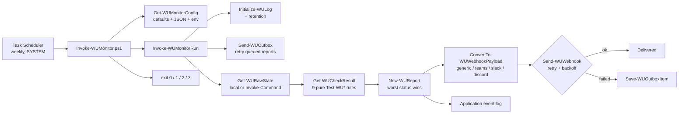

# Architecture

## Flow

## Layers

| Layer | Functions | Rule |
|---|---|---|
| Configuration | `Get-WUDefaultConfig`, `Get-WUMonitorConfig`, `Merge-WUConfig`, `Assert-WUConfig` | Invalid config fails fast with every problem listed |
| Collection | `Get-WURawState` | Read-only. Self-contained (no module dependencies) so it can run remotely. Each source has its own try/catch |
| Evaluation | `Test-WU*`, `Get-WUCheckResult` | Pure functions: input object in, `{Name, Status, Message}` out. No I/O, so every rule is unit-testable with a fixed clock |
| Reporting | `New-WUReport`, `ConvertTo-WUWebhookPayload` | One report per computer. Formatters only change presentation |
| Delivery | `Send-WUWebhook`, `Save-WUOutboxItem`, `Send-WUOutbox` | Never throws. Returns success/failure; failures are queued |
| Logging | `Initialize-WULog`, `Write-WULog`, `Remove-WUOldLog`, `Write-WUEventLog` | Falls back to `%TEMP%` if the log folder is not writable |

Separating **collection** (touches the system) from **evaluation** (pure logic) is the key decision. The thresholds and rules, where the bugs would be, are tested exhaustively without a real machine. The collector is small and tested with a mocked Windows Update Agent plus live integration runs.

## Design decisions

### 1. Local scheduled task on each machine (recommended), remote mode as an option
The Windows Update Agent COM API (`Microsoft.Update.Session`) is the most reliable source for update history and failures, but it is commonly refused with `E_ACCESSDENIED (0x80070005)` inside remote WinRM sessions. Running locally as SYSTEM avoids this and needs no WinRM, domain or firewall changes. Remote mode (`-ComputerName`) still works: if the COM call fails there, the collector falls back to `Get-HotFix` and reports `RecentFailures` as unavailable instead of guessing.

### 2. Read-only by construction, verified by tests
The tool only reads registry values, service start types, CIM data and update history. `tests/ReadOnly.Tests.ps1` parses the AST of every source file and fails on any state-changing command or method. File writes are only allowed inside the five functions that own the log and outbox. An integration test compares a before/after snapshot of the system.

Note: querying the Windows Update Agent can trigger-start the `wuauserv` service. This is normal Windows behaviour (opening *Settings > Windows Update* does the same) and does not change its configured start type, which is what the snapshot checks.

### 3. "Quality update" means the OS, not Defender
On a real machine the newest history entries are almost always *Security Intelligence Update for Microsoft Defender* (several per day). Counting them would make a machine whose OS hasn't been patched for 3 months look healthy. `History.ExcludePattern` removes Defender, .NET and MSRT, and `QualityUpdatePattern` matches both the older "Cumulative Update" and the newer "Security Update" titles.

### 4. A failed install only counts if it was never fixed
Windows retries updates. A KB that failed on Monday and installed on Tuesday is not a problem. The collector walks history newest-first and ignores failures of a KB that later succeeded, and counts each KB once.

### 5. Webhook delivery can fail; reports must not be lost
Retry with exponential backoff (2/4/8 s). No retry on 4xx (a wrong URL won't fix itself), except 408 and 429. After the final failure the payload goes to an outbox folder and is sent first on the next run. The exit code still reflects the **machine status**, not the delivery. Delivery problems go to event 1004 and the log.

### 6. Weekly heartbeat by default
`SendOn = Always` sends OK reports too. If a machine's weekly message stops arriving, that itself is a signal (task deleted, machine off, monitor broken). Noisy fleets can switch to `WarningOrAbove`.

### 7. Configuration is data, validated up front
All thresholds and the OS lifecycle table live in JSON. Missing keys fall back to defaults. Validation collects all problems at once (not just the first) and the run aborts with exit code 3 and an ALERT, rather than monitoring with bad thresholds.

### 8. Windows PowerShell 5.1 first
5.1 is on every Windows machine; PowerShell 7 often isn't. Implications handled:
- No `?:`/`??`, no `ConvertFrom-Json -AsHashtable` (custom converter).
- `$null -as [int]` is `0`, so the null-safe `ConvertTo-WUInt` is used for registry values.
- Source files are pure ASCII (5.1 reads BOM-less files as ANSI); emoji are built at runtime.
- TLS 1.2 is enabled explicitly before posting.
- CI runs the full suite on both 5.1 and 7.
